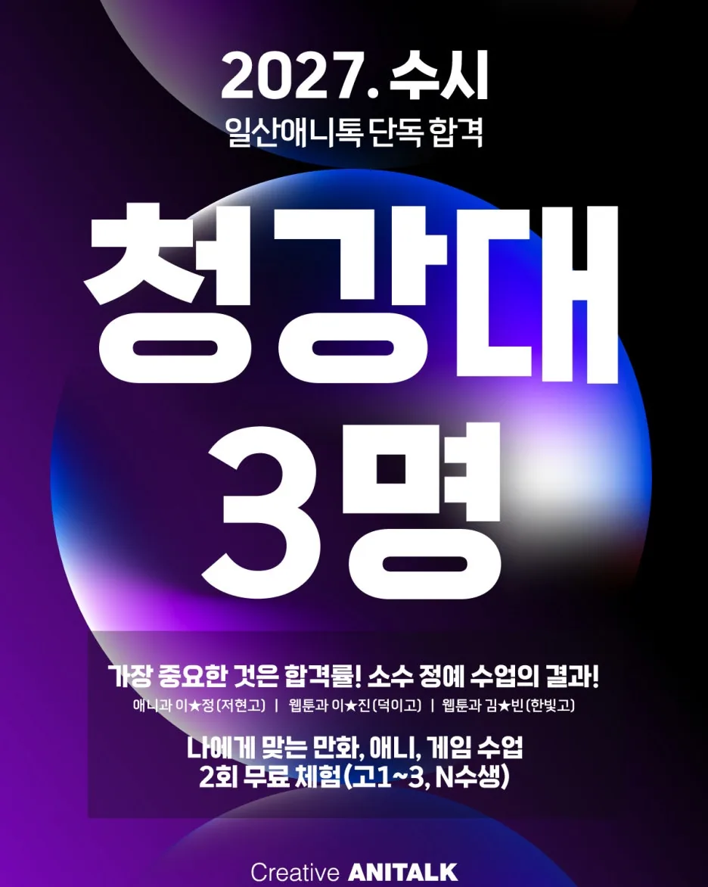
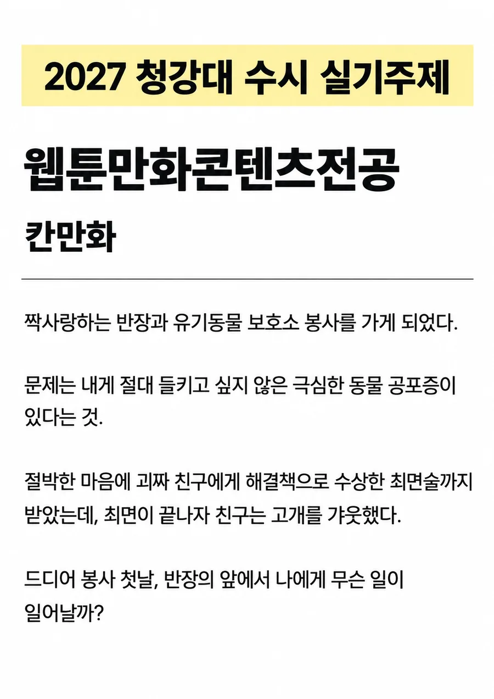
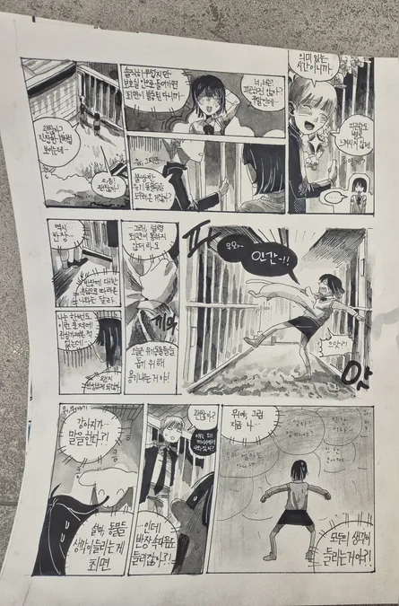
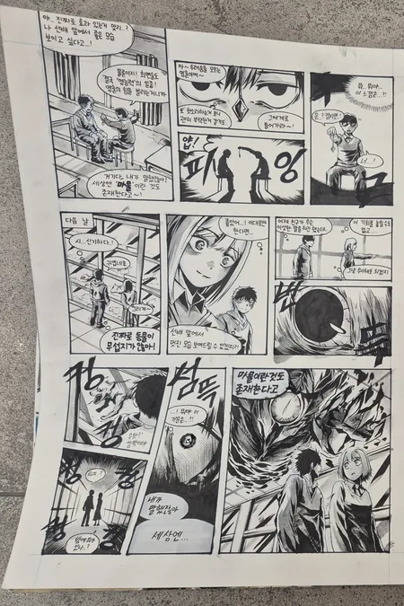
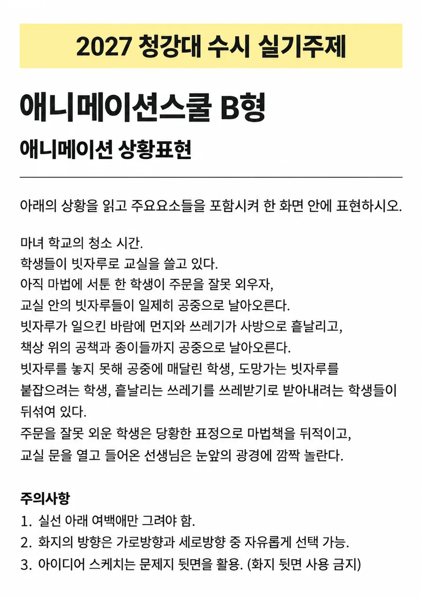
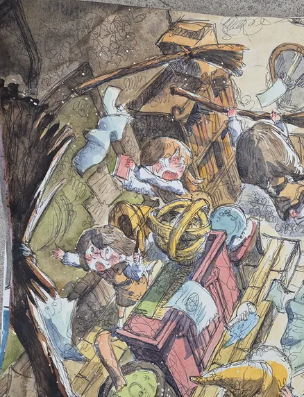

2027학년도 청강문화산업대학교 수시 합격자가 발표됐습니다. 답부터 드리면 **일산애니톡 실기 지원생 15명 중 3명이 최종 합격했습니다.** 애니메이션스쿨 1명, 웹툰만화콘텐츠전공 2명이고, 예비 번호를 받아 추가 합격을 기다리는 학생도 2명 더 있습니다.

## 한눈에 보는 2027 청강대 합격

1. 애니메이션스쿨 — 이 · 정 (저현고)
2. 웹툰만화콘텐츠전공 — 이 · 진 (덕이고)
3. 웹툰만화콘텐츠전공 — 김 · 빈 (한빛고)

합격생 이름은 학생 보호를 위해 가운데 글자를 가렸습니다. 전체 명단은 홈페이지 [합격생 명단](/#pass-list)에서 확인하실 수 있습니다.

## 웹툰만화콘텐츠전공 — 칸만화 주제

올해 웹툰과 칸만화 주제는 이런 상황이었습니다. 주인공은 짝사랑하는 반장과 함께 유기동물 보호소 봉사를 가게 됩니다. 문제는 절대 들키고 싶지 않은 극심한 동물 공포증이 있다는 것. 절박한 마음에 괴짜 친구에게 수상한 최면까지 받았는데, 최면이 끝나자 친구는 고개를 갸웃합니다. 그리고 봉사 첫날, 반장 앞에서 주인공에게 무슨 일이 일어날까요.

주제가 정해 주는 것은 상황까지입니다. **최면이 무엇을 바꿔 놓았는지**를 정하는 순간 이야기가 갈립니다. 같은 주제를 받은 두 합격생이 전혀 다른 답을 냈습니다.

### 김 · 빈 (한빛고) — 모두의 생각이 들리게 된 주인공

최면의 결과를 '생각이 들리는 능력'으로 풀었습니다. 무서운 줄만 알았던 강아지의 속마음이 들리기 시작하고, 이어서 사람의 생각까지 들리면서 이야기가 한 번 더 꺾입니다. 공포증이라는 약점이 오히려 사건을 여는 열쇠가 되도록 설계한 것이 이 작품의 힘입니다. 반전을 뒤에 몰지 않고 중간에 놓아, 그 뒤를 보여줄 칸을 충분히 남겼습니다.

### 이 · 진 (덕이고) — 보이지 않던 마물이 보이게 된 주인공

같은 최면을 '보이지 않던 것을 보게 되는 능력'으로 바꿨습니다. 주인공 눈에만 마물이 보이고, 이야기는 좋아하는 반장을 그 마물로부터 지켜야 하는 쪽으로 흘러갑니다. 동물 공포증이라는 작은 고민을 더 큰 위기로 키우면서도, 마지막에는 처음의 감정선인 반장으로 돌아와 칸만화를 닫았습니다. 흑백의 강한 대비와 효과음으로 긴장을 끌어올린 화면 운용도 눈여겨볼 만합니다.

## 애니메이션스쿨 — 상황표현 주제

애니과 상황표현 주제는 마녀 학교의 청소 시간이었습니다. 학생들이 빗자루로 교실을 쓸고 있는데, 아직 마법이 서툰 한 학생이 주문을 잘못 외우자 교실 안의 빗자루가 일제히 공중으로 날아오릅니다. 바람에 먼지와 쓰레기, 책상 위 공책과 종이까지 흩날리고, 빗자루에 매달린 학생, 도망가는 빗자루를 붙잡으려는 학생, 쓰레받기로 쓰레기를 받아내려는 학생이 뒤섞입니다. 주문을 잘못 외운 학생은 당황해 마법책을 뒤적이고, 문을 열고 들어온 선생님은 눈앞의 광경에 깜짝 놀랍니다.

등장인물이 많고 동작이 동시에 일어나는 주제입니다. 이런 주제에서는 모두를 같은 크기로 그리면 화면이 평평해집니다. **누가 이 장면의 주인공인지, 시선이 어디서 시작해 어디로 흐르는지**를 먼저 정해야 합니다.

### 이 · 정 (저현고)

화면을 크게 기울여 빗자루가 휩쓸고 지나가는 방향을 대각선으로 잡았습니다. 날아오르는 빗자루와 공중에 매달린 학생, 쏟아지는 소품이 한 방향의 흐름 안에 정리되어 있어 복잡한 상황이 한눈에 읽힙니다. 인물마다 다른 표정과 몸짓을 주어 '뒤섞여 있다'는 주제의 요구도 놓치지 않았습니다.

## 내신이 낮아도 실기로 길을 낼 수 있습니다

이 · 정 학생의 1학기 내신은 7.17등급이었습니다. 지난해에도 내신 7등급대 학생이 청강대에 합격했습니다. 실기 비중이 큰 전형에서는 내신만으로 결과가 정해지지 않습니다. 내신이 낮다는 이유로 미리 지원을 접기보다, 남은 시간 동안 실기를 얼마나 끌어올릴 수 있는지를 먼저 따져 보시길 권합니다. 다만 전형마다 반영 방식이 다르니 지원 전 모집요강은 꼭 확인하셔야 합니다.

## 합격생 수보다 합격률을 보셔야 합니다

학원을 고를 때 합격생 숫자만 보면 큰 학원이 늘 앞서 보입니다. 그보다 먼저 물어보셔야 할 것은 **지원한 학생 중 몇 명이 붙었는가**입니다. 일산애니톡은 소수정예로 학생 한 명 한 명의 장점을 살리는 수업을 합니다. 같은 주제에서 두 합격생이 전혀 다른 답을 낸 것도, 정답을 외우게 하지 않고 각자 잘하는 것을 키웠기 때문이라고 생각합니다.

합격한 학생들에게 진심으로 축하를 전합니다. 이번에 아쉬운 결과를 받은 학생들에게도 위로를 건넵니다. 오늘의 결과가 끝이 아니라 다음 시험을 준비하는 출발점이 되도록, 남은 전형까지 함께 준비하겠습니다.

## 상담 안내

청강대를 비롯해 만화·애니·게임 입시를 생각하고 있다면 한 곳만 보지 마시고 여러 학원을 비교해 보시길 권합니다. 일산애니톡에서는 만화애니 입시 경력 15년차 원장이 직접 상담하며, 상담을 받았다고 등록해야 하는 것은 아닙니다. 체험 수업으로 먼저 수업을 받아 보고 결정하셔도 됩니다.

일산애니톡은 경기도 고양시 일산동구 일산로 200, 백마학원가 투썸플레이스 건물 3층에 있습니다. 상담은 [네이버 예약](https://booking.naver.com/booking/6/bizes/626887/items/4216506)이나 전화 031-994-3134 로 신청하실 수 있습니다.
