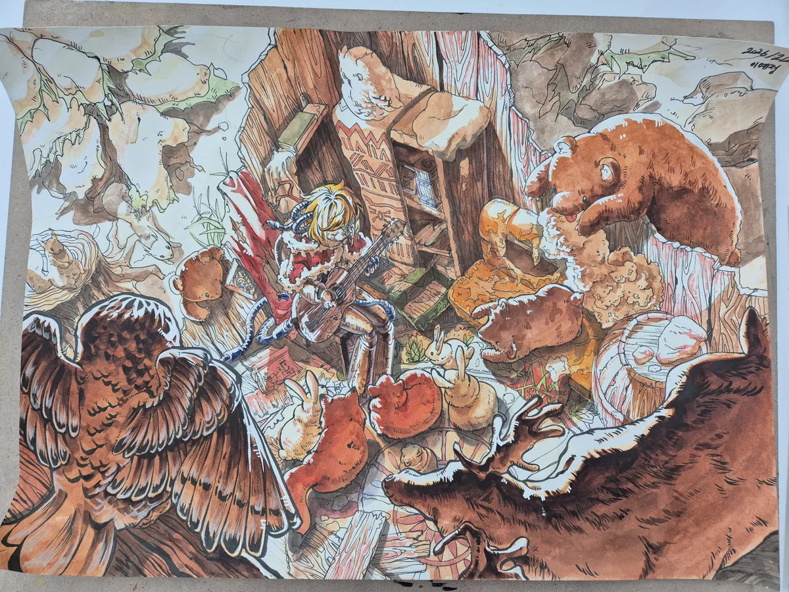
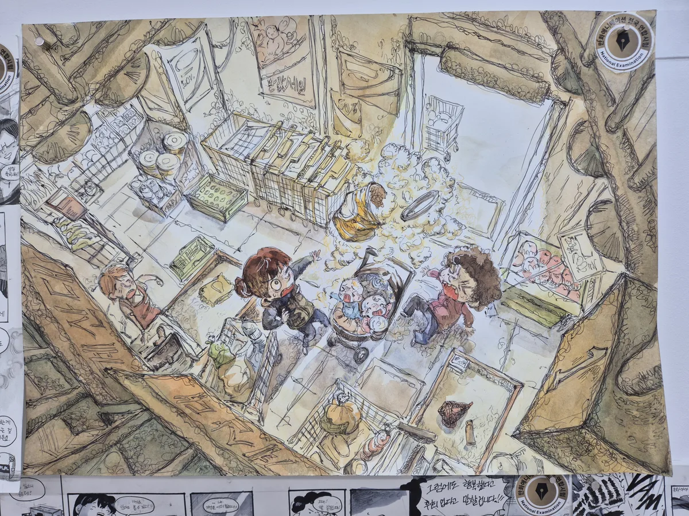
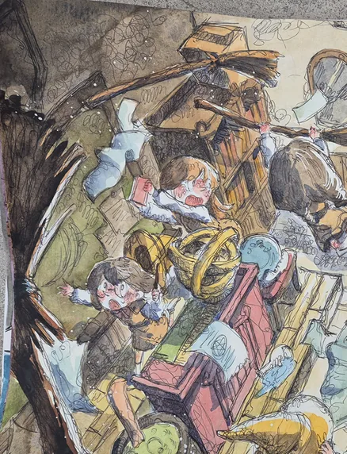

2027학년도 청강문화산업대학교 애니메이션스쿨 수시에 합격한 이 · 정 학생(저현고)의 이야기입니다. 이번 수시 경쟁률은 **15.69:1**이었습니다.

이 학생의 합격이 눈에 띄는 이유는 조건 때문입니다. **재수생**이었고, 1학기 성적 가운데 가장 좋은 것이 **7.17등급**이었으며, 스스로 **손이 느리고 시간 배분을 어려워하는 타입**이라고 말합니다. 학원 블로그에 따르면 작년 청강대 애니과 합격생 가운데 가장 낮은 내신이 6.5등급이었습니다. 실기에서 얼마나 높은 점수를 받았을지 짐작할 수 있는 대목입니다.

이 글은 조건이 불리하다고 느끼는 수험생이 이 사례에서 무엇을 가져갈 수 있는지를 중심으로 정리했습니다.

## 왜 애니메이션이었나

만화도 게임도 좋아했지만, 이 · 정 학생이 가장 끌린 것은 **화면 안에서 캐릭터를 움직이게 하는 일**이었습니다. 그래서 애니메이션 전공을 중심으로 원서를 냈습니다. 실기 경력은 약 3년입니다.

## 재수의 첫 과제: 작년과 다른 그림

같은 방식으로 한 해를 더 하면 같은 결과가 나올 수 있습니다. 이 학생은 그래서 **작년과 다른 스타일로 시험을 치르는 것**을 첫 과제로 삼았습니다.

1. 방향을 먼저 정했다 — 동화 삽화 같은 느낌
2. 선생님이 준 자료를 모작하고, 고치면서 자기 것으로 만들었다
3. 평소작이든 시험이든 자료를 충분히 보고 들어갔다
4. 피드백을 받으면 미루지 않고 그대로 반영해 고쳤다

기본 바탕은 학원 커리큘럼이었습니다. 새 스타일을 만든다고 기본 과정을 건너뛴 것이 아니라, 커리큘럼을 따라가면서 그 위에 방향을 바꿨다는 점이 중요합니다.

## 성장을 확인한 순간

학원 생활에서 가장 기억에 남는 일은 **전국연합시험에서 A권대를 받아 작품이 테이블에 올라간 것**이었습니다. 현역 때는 한 번도 받지 못했던 평가였기에, 스스로 성장했다는 걸 처음 실감한 순간이었다고 합니다.

## 상황표현 주제, 인물의 연기부터 잡았다

올해 애니메이션스쿨 상황표현 주제는 '마녀들의 청소 시간'이었습니다. 주문을 잘못 외운 학생 때문에 교실의 빗자루가 일제히 날아오르고, 먼지와 종이가 흩날리는 가운데 학생들이 저마다 다른 행동을 하고, 문을 열고 들어온 선생님이 놀라는 장면입니다. 주제 전문과 재현작은 [2027 청강대 수시 합격 정리 글](/blog/cheonggang-2027-early-admission-results/)에 있습니다.

판타지는 이 학생이 자신 있어 하던 분야여서 더 집중할 수 있었다고 합니다. 푸는 순서는 이랬습니다.

- **공간** — 마녀들이 다니는 학교라면 교실이 어떻게 생겼을지부터 정했다
- **배치** — 주인공의 위치를 먼저 잡고, 나머지 인물은 보는 사람의 시선 흐름을 따라 놓아 주인공의 연기를 가리지 않게 했다
- **연기** — 가장 공을 들인 부분. 주인공은 "어서 해결 방법을 찾아야 해" 하는 초조함이 보이도록, 마법서를 뒤지는 손, 긴장해 올라간 어깨, 구부정한 자세, 당황한 표정으로 표현했다
- **조연** — 도망가는 빗자루를 잡으려는 학생은, 등장인물이 마녀 학생이라는 설정을 살려 지팡이를 휘둘러 빗자루를 잡으려는 동작으로 그렸다

상황표현은 등장인물이 많아질수록 화면이 산만해지기 쉽습니다. 이 학생은 **주인공 한 명의 감정을 먼저 세우고 나머지를 거기에 맞춰 배치하는 순서**로 그 문제를 피했습니다.

## 손이 느린 학생의 시간표

이 · 정 학생이 학원에서 가장 크게 도움받았다고 꼽은 것은 **시간 관리**입니다. 손이 느려도 완성할 수 있도록 단계별 시간표를 함께 짰습니다. 현역 때 하던 실기 종목이 맞지 않는 것 같아 종목을 바꿀 때도 상담을 받았습니다. 정해진 방법을 따라가기보다, 입시를 자기에게 맞는 방식으로 할 수 있게 도움을 받았다고 정리합니다.

## 시험 멘탈을 지킨 두 가지 습관

합격 비결을 묻자 학생은 "어느 정도의 운과 긍정적인 마음"이라고 답했습니다. 구체적으로는 두 가지 습관이었습니다.

- **일단 완성한다.** 시험 도중 크게 실수하거나 마음에 안 들어도, 생각한 대로 끝까지 완성하는 것을 원칙으로 삼았습니다.
- **결과를 다음으로 연결한다.** 잘 나온 날엔 "이대로 쭉 가자", 잘 안 된 날엔 "피드백 받고 발전하자"고 생각했습니다.

이 습관 덕분에 실제 시험장에서는 마음이 크게 흔들리거나 긴장하지 않았다고 합니다. 사람이 많아 조금 부산스러웠지만 다들 열심히 하는 분위기였다고 고사장을 기억합니다.

## 성적에 대해 솔직하게

이 학생은 성적이 좋지 않았기 때문에 성적보다는 그림에 더 힘을 쏟았다고 솔직하게 말합니다. 모든 학생에게 권할 방법은 아니지만, 실기 비중이 큰 전형을 노린다면 자신의 강점에 시간을 몰아주는 것도 하나의 전략이 될 수 있습니다. 지원할 전형의 내신 반영 방식은 반드시 먼저 확인해야 합니다.

## 후배에게

입시를 하다 보면 그림이 안 그려져 속상하고, 가는 길이 맞는지 의심될 때가 옵니다. 이 · 정 학생은 그럴 때 **"나는 잘하고 있어"라고 생각하며 자기 속도대로 꾸준히 가라**고 말합니다. 그리고 열심히 할 때 열심히 하되, 자기 몸을 돌보는 것도 잊지 말라고 덧붙였습니다.

## 함께 읽으면 좋은 글

- [2027 청강대 수시 합격 — 실기 주제와 재현작](/blog/cheonggang-2027-early-admission-results/)
- [만화를 몰랐던 학생이 1년 10개월 만에 청강대 웹툰과에 붙기까지](/blog/cheonggang-webtoon-2027-feedback-interview/)
- [소년만화 하나로 청강대 칸만화 합격](/blog/cheonggang-comics-2027-shonen-interview/)

일산애니톡은 고3 · N수생 정시 특강과 고1 · 고2 입시반을 운영합니다. 내신이나 손 속도 때문에 고민이라면, 지금 그림을 함께 보고 맞는 전형과 종목부터 같이 정해 드립니다.
