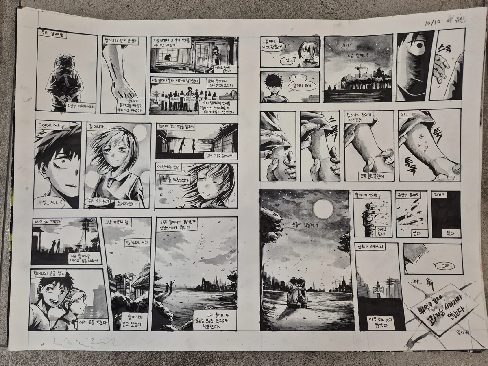
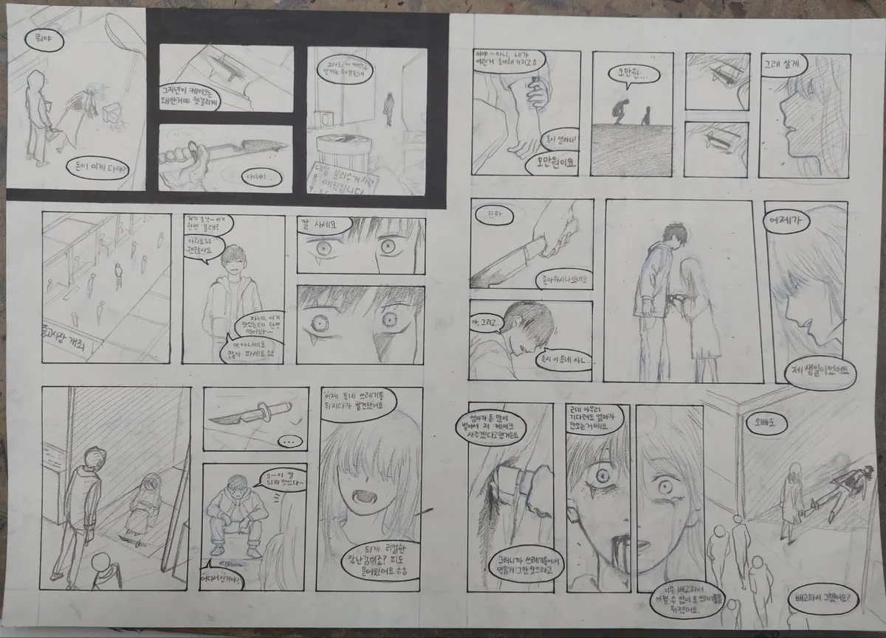
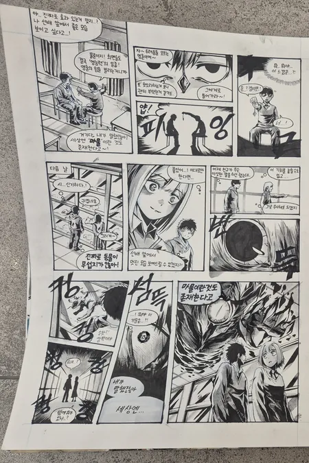

2027학년도 청강문화산업대학교 웹툰만화콘텐츠전공에 칸만화 전형으로 합격한 이 · 진 학생(덕이고)의 이야기입니다. 실기 경력은 약 3년입니다.

이 · 진 학생의 준비 과정을 한 줄로 줄이면 이렇습니다. **좋아하는 장르를 정하고, 그 장르를 끝까지 밀고 갔다.** 입시 미술은 정해진 답을 그리는 것이라고 생각하기 쉽지만, 이 학생은 반대로 자기가 가장 좋아하는 것을 무기로 삼았습니다.

## 세 종목 가운데 칸만화를 고른 이유

청강대 웹툰과 실기에는 이미지보드, 상황표현, 칸만화가 있습니다. 이 · 진 학생은 그중 **칸만화에 가장 흥미와 재미를 느꼈습니다.** 그림에서는 고집이 있는 편이라, 입시 미술이라도 자기가 좋아하는 것을 그리고 싶다는 마음이 분명했다고 합니다. 그래서 좋아하는 것을 가장 잘 드러낼 수 있는 종목으로 칸만화를 택하고, 선생님께 먼저 하고 싶다고 말했습니다.

## 장르를 찾고, 다듬고, 반복했다

준비는 세 단계였습니다.

1. **잘하는 것을 찾는다** — 이 · 진 학생에게 그것은 액션 소년만화였다. 다른 장르보다 확실히 잘 그렸고, 무엇보다 좋아했다
2. **그것을 다듬는다** — 선생님이 "너는 벅차오르는 느낌의 소년만화로 가자"며 방향을 확실히 정해 줬다. 2페이지 칸만화에서 이 장르를 가장 잘 보여 주려면 기승전결은 어떻게 짜고, 칸은 어떻게 나누고, 분위기는 어떻게 맞출지 설계했다
3. **반복하며 성장한다** — 같은 틀 안에서 소재를 바꿔 가며 계속 그렸다

주로 쓴 소재는 용사, 히어로, 메카, 요리사, 달리기 선수, 특수 요원이었습니다. 소재가 무엇이든 기준은 하나였습니다. **'멋지게'.** 요리사라면 멋지게 요리하고, 히어로라면 멋지게 물리친다. 그리고 모든 소재에 공통으로 **'성장'**을 넣었습니다. 소년만화에 성장이 빠지면 안 되기 때문입니다.

## 가장 어려웠던 채색, 직접 물어서 넘었다

이 학생에게 가장 큰 고비는 채색이었습니다. 색을 참고하던 만화를 그린 선생님께 직접 연락해 도움을 받기도 했고, 선생님께 정말 많이 질문했습니다. 시간이 오래 걸린 만큼, 컬러에 익숙해졌을 때의 성취감도 컸다고 합니다.

## 1등보다 기뻤던 것

학원이 주관한 연합시험에서 이 · 진 학생은 **1등**을 했습니다. 그때 그린 칸만화는 지금도 가장 잘 나온 작품으로 꼽고, 그 작품의 컷 구성을 입시 끝까지 활용했습니다.

하지만 학생이 더 기뻤던 것은 등수가 아니라 **"나는 성장하고 있구나"를 스스로 확인한 것**이었다고 합니다. 그래서 매 시험을 그냥 흘려보내지 않고 더 좋은 작품을 뽑으려 했고, 그 경험이 끝까지 가는 동기가 됐습니다.

## 낯선 주제를 자기 장르로 끌어오기

시험장에서 받은 주제는 '짝사랑하는 반장과 유기동물 보호소 봉사, 숨기고 싶은 동물 공포증, 그리고 수상한 최면술'이었습니다. 멋진 소년만화를 파 온 학생에게 '짝사랑'과 '동물'은 낯선 단어였고, 처음에는 꽤 당황했다고 합니다.

그래도 **어떤 주제가 나와도 침착하게, 해 온 것을 하자**고 마음먹고 주제를 분석했습니다.

- 주제의 요소를 골라낸다: 짝사랑, 유기동물 보호소, 극심한 동물 공포증, 최면술
- 그중 자기 장르와 이어질 수 있는 것을 고른다: 초능력 느낌이 있는 '최면술'
- 그 요소를 열쇠로 이야기를 소년만화 쪽으로 끌고 간다

최면술을 '영혼의 힘을 빌리는 능력'으로 다시 해석한 이 학생의 답안은 [2027 청강대 수시 합격 정리 글](/blog/cheonggang-2027-early-admission-results/)에 자세히 소개되어 있습니다. 시험에서도 기준은 같았습니다. 어떤 대사를 쳐야 멋있을지, 구도와 포즈는 어떻게 잡아야 멋있을지 끝까지 고민했습니다.

이 사례에서 배울 점은 장르를 고집한 것이 아니라 **장르로 가는 길을 주제 안에서 찾아낸 것**입니다. 드라마나 코미디는 주제 안에서 이야기를 풀기 쉽지만, 소년만화는 주제에 쓸 만한 소재가 없으면 직접 가져와야 합니다. 이 학생은 그게 가장 어려웠다고 털어놓으면서도, 그 연습을 몇 번이고 반복했습니다.

## 3년 내내 내신 3등급대 이상

이 · 진 학생은 고등학교에 들어가면서 **만화학원을 제외한 다른 학원을 모두 그만뒀습니다.** 그림에 집중하겠다는 다짐이었고, 혼자서도 해낼 수 있다는 자신감이었습니다. 그만큼 온전히 공부할 수 있는 시간은 학교 수업 시간뿐이었습니다.

- 수업 시간에 조는 것은 스스로 용납하지 않았다
- 선생님의 필기와 시험 힌트를 최대한 받아 적었다
- 처음엔 노트에, 나중엔 교과서와 학습지를 스캔해 패드에 디지털로 필기했다
- 시험이 다가오면 필기와 미리 사 둔 개념 문제집으로 주말과 남는 시간에 복습했다

그 결과 **1학년 초부터 3학년 말까지 3등급대 이상**을 놓치지 않았습니다. "나는 미대 입시생이니까"라며 공부를 미루지 않으려 했다고 합니다. 시간이 적을 뿐, 공부는 공부대로 할 수 있고 해야 한다는 것이 이 학생의 생각입니다.

## 시험장을 내 것으로 만드는 상상

고사장에 대해 이 · 진 학생은 "즐거웠다"고 표현합니다. 모두가 진지하고 간절한 분위기였지만, 그 분위기에 눌리지 않고 함께 올라탔다고요.

소년만화에는 초반에 큰 시험을 치르는 에피소드가 많습니다. 이 학생은 고사장에 들어갈 때마다 그 장면 속에 들어간 기분이었다고 합니다. 수많은 사람 한가운데서 자기 능력을 펼치는 주인공처럼요. 정답이 정해진 문제를 푸는 시험과 달리 **실기 시험은 나를 보여 주는 시험**이라는 생각이, 긴장을 설렘으로 바꿔 줬습니다.

## 합격 비결: 배운 것을 의심하지 않기

이 · 진 학생이 꼽은 비결은 두 가지입니다.

첫째, **배워 온 것을 의심하지 않는 것.** 자기 실력을 의심한 적은 많았지만, 선생님께 듣고 배운 것은 의심하지 않았습니다. 확신이 서지 않으면 질문해서 답을 찾았습니다. 주제 지문을 보기 직전까지 "내가 배운 것을 하자"를 되뇌었습니다.

둘째, **만화를 좋아하는 것.** 좋아하니 더 잘하고 싶고, 잘하고 싶으니 더 노력할 수 있었다고 합니다. 자기 그림뿐 아니라 다른 학생들의 만화까지 좋아했습니다.

학원에 대해서는 "잘하는 것을 더 잘하게, 좋아하는 것을 더 좋아하게 해 준 곳"이라고 정리했습니다. 수업이 끝나는 밤 10시에 "조금만 더 하다 가도 돼요?"라고 농담처럼 묻곤 했을 만큼, 어느 공간보다 학원이 좋았다고 합니다.

## 후배에게: 친구들의 그림을 모두 보세요

이 · 진 학생의 조언은 구체적입니다. **같은 반에서 함께 입시를 하는 친구들의 그림을 모두 보라**는 것입니다. 친하든 아니든 상관없이, 전체 평가 시간에는 모두의 그림과 그 평가를 주의 깊게 들으라고 합니다.

내 그림에는 바뀐 점보다 반복되는 점이 더 많습니다. 다른 사람의 그림에는 내가 해 보지 못한 것, 못 하는 것이 들어 있습니다. 장르가 달라서 쓸 게 없다고 생각하지 말라고 합니다. 우리가 그려야 하는 것은 좋은 그림이고, 좋은 그림에는 장르가 없기 때문입니다.

그리고 마지막으로 이렇게 남겼습니다. **"잘하려고 하지 말고, 좋아하려고 해 주세요. 그럼 잘하게 될 겁니다."**

## 함께 읽으면 좋은 글

- [2027 청강대 수시 합격 — 실기 주제와 재현작](/blog/cheonggang-2027-early-admission-results/)
- [만화를 몰랐던 학생이 1년 10개월 만에 청강대 웹툰과에 붙기까지](/blog/cheonggang-webtoon-2027-feedback-interview/)
- [내신 7등급대 재수생의 청강대 애니과 합격기](/blog/cheonggang-animation-2027-interview/)

좋아하는 장르가 분명한데 입시에 맞을지 걱정된다면, 그 그림을 들고 상담을 받아 보세요. 일산애니톡은 학생이 가장 좋아하는 것에서 입시 방향을 찾습니다.
