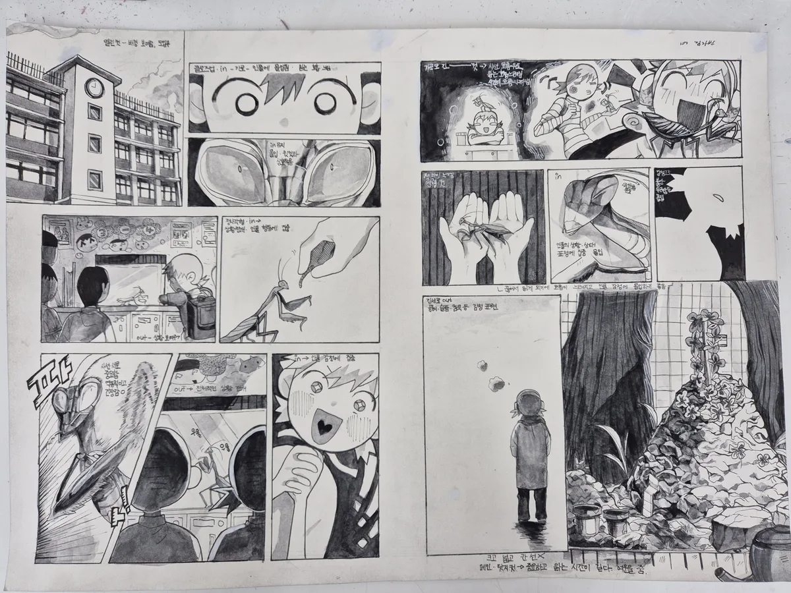
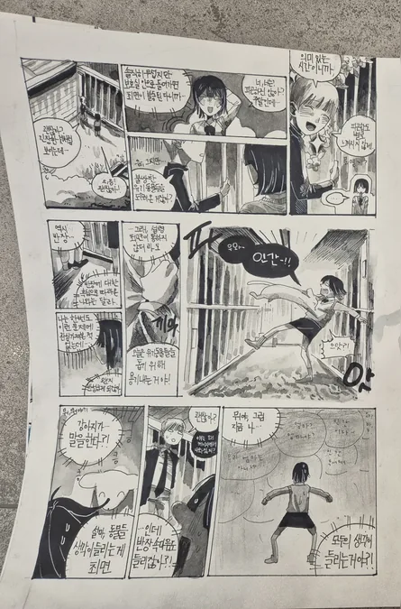

2027학년도 청강문화산업대학교 웹툰만화콘텐츠전공(만화웹툰과)에 합격한 김 · 빈 학생(한빛고)의 이야기입니다. 학원이 정리한 올해 경쟁률은 **실기전형 16.97:1, 면접전형 11.48:1**이었습니다.

김 · 빈 학생은 스스로를 "만화에 대해 거의 아는 게 없는 **백지상태**"로 학원에 들어왔다고 소개합니다. 실기 경력은 **약 1년 10개월**. 처음 네 시간짜리 시험을 본 날에는 "대학 못 가겠는데?"라는 생각까지 했던 학생이 1지망 학교에 붙기까지, 무엇을 했는지 정리했습니다.

## 이야기와 그림, 둘 다 하고 싶어서

이야기를 만드는 것과 그림을 그리는 것을 둘 다 좋아했기 때문에, 스토리와 그림을 함께 하는 만화웹툰과를 골랐습니다.

## 성장의 핵심은 '같은 지적을 두 번 받지 않기'

김 · 빈 학생의 준비 방식은 화려하지 않습니다. 대신 꾸준했습니다.

1. **숙제를 최우선으로** — 학원 숙제를 빠짐없이 해 가는 것을 가장 먼저 챙겼다
2. **피드백을 적는다** — 받은 피드백을 메모하고, 한 번 지적받은 부분은 다음 만화에서 다시 보이지 않도록 신경 썼다
3. **수업을 다시 본다** — 연출과 스토리 수업 내용도 메모해 두고 돌려 보며 실제 만화에 써먹었다
4. **연출 노트를 만든다** — 시간이 남을 때는 개인 연출 노트를 따로 작성해 피드백을 받았다

이 네 가지는 누구나 바로 시작할 수 있는 습관입니다. 특히 2번이 중요합니다. 피드백을 듣기만 하고 적지 않으면, 다음 작품에서 같은 말을 또 듣게 됩니다.

## "대학 못 가겠는데?"에서 1지망 합격까지

처음 4시간 시험을 본 날, 김 · 빈 학생은 몇 달 더 해 봐야 크게 달라지지 않을 것 같다고 생각했습니다. 그런데 결과적으로 1지망 학교에 합격했습니다.

학생 본인은 그림 실력이 눈에 띄게 늘었다기보다, **만화를 그리는 과정 자체가 확실히 수월해졌다**고 돌아봅니다. 처음 시험을 보고 막막했던 학생이라면 이 대목을 기억해 두면 좋겠습니다. 실력은 결과물보다 과정에서 먼저 늘어납니다.

## 칸만화 주제를 세 단계 줄거리로

올해 웹툰과 칸만화 주제는 이랬습니다. 짝사랑하는 반장과 유기동물 보호소 봉사를 가게 됐지만, 주인공에게는 절대 들키고 싶지 않은 극심한 동물 공포증이 있습니다. 괴짜 친구에게 수상한 최면까지 받았는데, 최면이 끝나자 친구는 고개를 갸웃합니다. 봉사 첫날 반장 앞에서 무슨 일이 일어날까요.

김 · 빈 학생은 학원에서 배운 순서대로 접근했습니다. 먼저 **주제가 어떤 정보를 주고 있는지 분석**하고, 그중 **반드시 보여야 할 것**이 무엇인지를 가장 먼저 정했습니다. 그다음 주인공 설정을 잡고, '최면술'과 '유기동물'이라는 두 키워드를 평소에 쓰던 플롯으로 자연스럽게 끌고 갈 방법을 고민했습니다.

그렇게 나온 줄거리는 세 단계입니다.

- **최면의 결과** — 최면으로 동물의 마음을 알 수 있게 된 주인공은 짝사랑하는 반장의 속마음까지 듣게 된다
- **알게 된 것** — 반장의 숨겨진 모습과, 들리지 않아 몰랐던 유기동물들의 안타까운 사정을 알게 된다
- **선택** — 봉사 기간이 끝나고 반장은 더 이상 보호소에 가지 않지만, 주인공은 동물들을 돕기 위해 혼자 보호소를 찾는다

짝사랑으로 시작한 이야기가 주인공의 선택으로 끝나는 구조입니다. 주제가 정해 준 상황 위에 주인공이 무엇을 깨닫고 어떻게 달라지는지를 얹은 것이 이 답안의 힘입니다.

## 마지막 몇 분까지 검토했다

김 · 빈 학생은 합격 비결로 **긴장하지 않고 차분하게 그린 것**을 꼽았습니다. 고사장도 다들 자기 일에 집중하는 차분한 분위기여서, 사람이 많았는데도 긴장이 별로 되지 않았다고 합니다.

특히 시험이 끝나기 직전까지 세 가지를 계속 확인하고 고쳤습니다.

- 주제에서 엇나간 부분은 없는가
- 스토리에 구멍은 없는가
- 대사에 어색한 곳은 없는가

칸만화는 그림을 다 그린 뒤에도 고칠 것이 남는 시험입니다. 남은 시간을 그림 다듬기에만 쓰지 않고 이야기를 다시 읽는 데 쓴 것이 차이를 만들었습니다.

## 내 장점을 남이 먼저 찾아 줄 때

학원에서 받은 도움을 묻자, 김 · 빈 학생은 연출, 스토리, 드로잉까지 모든 방면이었다고 답했습니다. 그중에서도 **자기도 몰랐던 장점을 찾아내 강점으로 만들 수 있게 하나하나 짚어 준 것**이 합격에 가장 크게 작용했다고 말합니다.

입시 초반과 후반에 그린 만화의 느낌이 거의 다를 정도로 달라졌고, 본인조차 그런 만화를 그리게 될 줄 몰랐다고 합니다. 늘 할 수 있다고 믿어 준 덕분에 친구들과 함께 마음을 다잡을 수 있었다는 이야기도 덧붙였습니다.

## 공부는 틈틈이, 좋아하는 과목부터

학원에 나오지 않는 주말이나, 학원 가는 전철 안에서 틈틈이 공부했습니다. 못하는 과목에 매달리기보다 좋아하는 과목을 열심히 해서 점수를 최대한 끌어올리는 쪽을 택했습니다.

## 후배에게

김 · 빈 학생이 꼽은 가장 중요한 것은 **선생님 말씀을 믿고, 새겨듣고, 따르는 것**입니다. 시간이 아쉬울 정도로 빨리 갔다며, 재밌다는 마음으로 그림을 그리면 입시도 즐겁게 할 수 있다고 전했습니다.

## 함께 읽으면 좋은 글

- [2027 청강대 수시 합격 — 실기 주제와 재현작](/blog/cheonggang-2027-early-admission-results/)
- [소년만화 하나로 청강대 칸만화 합격](/blog/cheonggang-comics-2027-shonen-interview/)
- [내신 7등급대 재수생의 청강대 애니과 합격기](/blog/cheonggang-animation-2027-interview/)

만화를 좋아하지만 어디서부터 시작해야 할지 모르겠다면, 지금 그린 그림 몇 장을 가지고 상담을 받아 보세요. 일산애니톡은 학생 한 명 한 명의 장점을 찾는 데서 입시를 시작합니다.
