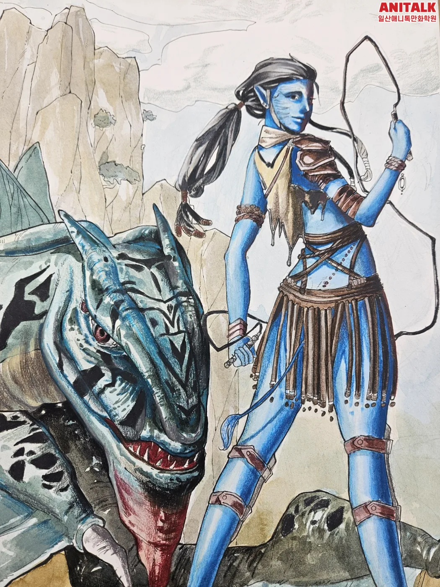

2027학년도 한국애니메이션고등학교(한국애니고) 만화창작과에 일산애니톡 학생 한 명이 합격했습니다. 이 · 교 학생은 처음부터 입시를 목표로 들어온 학생이 아니었습니다. **중학교 2학년 때는 주니어반에서 취미로 그림을 그렸고**, 예비반을 거쳐 입시반으로 옮긴 뒤 **약 10개월** 동안 시험을 준비했습니다.

이 글은 그 과정을 한국애니고를 생각하는 중학생과 학부모님이 바로 참고할 수 있는 순서로 다시 정리한 것입니다. 앞부분은 합격생이 직접 들려준 준비 과정이고, 뒷부분은 2027학년도 입학전형 요항을 바탕으로 한 한국애니고 입시 정보입니다.

## 취미반에서 입시반까지, 어떻게 옮겨 갔나

이 · 교 학생은 어릴 때부터 그림 그리기를 좋아했고, 한국애니고라는 학교를 알게 된 뒤로 줄곧 이곳을 목표로 삼았습니다. 위 그림은 아직 입시를 시작하기 전, 주니어반에서 그린 평소작입니다.

준비는 세 단계로 이어졌습니다.

1. **주니어반** — 좋아하는 그림을 마음껏 그리던 시기
2. **예비반** — 2026년 1월부터, 입시에 필요한 기본 드로잉을 잡는 시기
3. **입시반** — 실제 시험 형식에 맞춰 연습하는 시기

입시반에서 가장 효과가 있었던 것은 **모의시험**이었다고 합니다. 여름방학 특강부터 시험 시간을 조금씩 줄여 가며 실제 시험처럼 풀어 봤고, 그 덕분에 시험장에서 시간에 쫓기지 않았습니다.

## 약점이던 수채를 어떻게 넘었나

한국애니고 만화창작과는 칸만화를 펜으로 마무리한 뒤 주인공과 배경을 투명 수채로 한 장 더 그려야 합니다. 이 · 교 학생에게는 이 수채가 가장 어려운 과제였습니다.

여러 선생님이 돌아가며 시범을 보여 줬고, 학생은 그걸 보며 붓질과 색 정리를 하나씩 바꿔 나갔습니다. 어느 날 한 선생님에게서 "많이 깔끔해졌다"는 말을 들은 순간이 학원 생활에서 가장 뿌듯했던 기억이라고 합니다. 약점 하나를 여러 사람의 눈으로 함께 고친 셈입니다.

## 시험 주제를 받고 이야기부터 세웠다

2027학년도 실기에서는 웹툰 연출을 다룬 참고서의 지문이 함께 나왔습니다. 주제는 **주인공이 재난 상황에서 다른 사람을 구하려는 장면**이었고, 시간이 빠르게 흐르는 부분과 느리게 흐르는 부분, 이야기에서 중요한 대목이 컷 연출로 드러나야 했습니다.

이 · 교 학생은 평소 습관대로 **연출보다 이야기를 먼저** 정했습니다. 그중에서도 주인공이 어떤 사람인지부터 세웠습니다.

- 주인공: 히어로를 동경했지만 현실에 부딪혀 절망한 사람
- 사건: 그런 주인공이 위기에 빠진 사람을 구한다
- 전환: 구해 준 사람에게서 "당신이 제 히어로입니다!"라는 말을 듣는다
- 결말: 그 한마디로 주인공이 절망에서 빠져나온다

이야기가 서고 나서야 "어느 컷에서 시간을 늘리고, 어느 컷에서 몰아칠지"를 주제의 조건에 맞춰 배치했습니다. 주인공의 감정이 바뀌는 지점이 분명하니 시간의 완급을 줄 자리도 자연스럽게 정해졌습니다.

학생은 합격 비결로 **스토리**를 꼽았습니다. 평소에도 글 쓰는 것을 좋아해 이야기를 만드는 데 익숙했고, 그 경험이 시험장에서 이야기를 빨리 떠올리는 힘이 됐다고 합니다.

## 고사장과 면접에서 있었던 일

고사장은 아주 조용했고, 수험생 대부분이 크로키를 하며 손을 풀고 있었다고 합니다.

면접에서는 **만화에서 본인의 약점이 무엇인지**를 묻는 질문이 나왔습니다. 이 · 교 학생은 이 질문을 약점을 들키는 자리가 아니라, 그 약점을 고치려고 노력한 과정을 보여 줄 기회로 받아들였습니다. 수채를 고쳐 온 과정처럼 실제로 겪은 이야기가 있으면 이런 질문에 답하기가 훨씬 쉽습니다.

## 내신은 이렇게 챙겼다

수학과 영어는 학원에 다녔고, 나머지 과목은 학교 수업에 집중한 뒤 자습서와 문제집으로 복습했습니다. 아래 표에서 보듯 한국애니고 일반전형은 내신으로 실기 응시자를 먼저 거르기 때문에, 그림 연습과 내신은 둘 중 하나를 고르는 문제가 아닙니다.

## 후배에게: 크로키를 습관으로

이 · 교 학생이 후배들에게 남긴 조언은 하나였습니다. **평소에 크로키를 하며 드로잉을 연습해 두라**는 것. 시험 직전에 몰아서 할 수 있는 연습이 아니기 때문입니다.

학원에서 도움을 받은 부분으로는 합격 재현작 자료, 학교에 관한 정보, 그리고 기본기를 꼽았습니다.

## 한국애니고 입시 한눈에 보기 (2027학년도 요항 기준)

아래 내용은 한국애니메이션고등학교가 발표한 2027학년도 신입생 입학전형 요항을 정리한 것입니다. 해마다 달라질 수 있으니 지원 전에는 반드시 학교 공지를 다시 확인해 주세요.

### 학교와 학과

한국애니고는 경기도 하남시에 있는 특성화고로, 전국에서 지원할 수 있습니다. 학과는 만화창작과, 애니메이션과, 영상연출과, 컴퓨터게임제작과 네 곳이고 **학과마다 24명, 한 학년 96명**을 뽑습니다. 학과끼리 중복 지원은 할 수 없습니다. 학생들은 '애니홈'이라는 기숙사에서 생활합니다.

### 만화창작과 모집 인원

| 전형 | 인원 |
| --- | --- |
| 진로적성 특별전형 | 8명 |
| 일반전형 — 경기도 우선선발 | 8명 |
| 일반전형 — 일반선발 | 8명 |

### 2027학년도 일정

- **특별전형** — 원서 접수 11월 3일~5일 → 실기 · 면접 11월 10일 → 합격 발표 11월 11일
- **일반전형** — 원서 접수 11월 12일~13일 → 실기 11월 17일 → 합격 발표 11월 23일

면접은 특별전형에서만 봅니다. 특별전형에서 떨어져도 일반전형에 다시 지원할 수 있습니다.

### 실기

모든 학과가 **4시간** 동안 실기를 봅니다.

- **만화창작과** — ① 주어진 주제로 칸만화를 그리고 펜터치로 완성(B4) ② 칸만화 속 주인공과 배경을 투명 수채로 표현(A4). 펜터치는 학교에서 나눠 주는 볼펜으로만 하며 붓펜·화이트·수정테이프·마카는 쓸 수 없습니다.
- **애니메이션과** — 캐릭터 시트 30점, 이미지보드 70점

### 내신과 점수 구성

일반전형은 **내신 100점 + 실기 100점**입니다. 1단계에서 내신으로 먼저 뽑고, 만화창작과와 애니메이션과는 모집 인원의 **6배수**가 2단계 실기를 봅니다.

| 학기 | 반영 비율 |
| --- | --- |
| 1학년 2학기 | 10% |
| 2학년 1학기 | 20% |
| 2학년 2학기 | 20% |
| 3학년 1학기 | 25% |
| 3학년 2학기 | 25% |

반영 과목은 국어, 사회(역사), 수학, 과학, 영어입니다. 2027학년도부터 1학년 2학기 성적이 새로 들어갔습니다. 출결과 봉사활동도 점수에 들어가며, 미인정 지각·조퇴·결과 3번은 미인정 결석 1일로 계산하고 봉사활동은 15시간 이상이면 만점입니다.

특별전형은 200점 만점입니다. 교과 성적 20점, 출결 20점, 봉사활동 10점, 취업·창업 계획서 20점, 자기소개서 30점, 실기 50점, 면접 50점이고, 1단계에서 2배수를 뽑은 뒤 2단계에서 실기와 면접을 봅니다.

### 참고: 2024학년도 경쟁률과 내신 평균

경쟁률

| 학과 | 특별전형 | 일반전형 |
| --- | --- | --- |
| 만화창작과 | 12.88:1 | 7.13:1 |
| 애니메이션과 | 11.38:1 | 6.19:1 |

합격자 내신 점수 평균

| 학과 | 특별전형 | 일반전형 |
| --- | --- | --- |
| 만화창작과 | 198.93 | 195.67 |
| 애니메이션과 | 199.53 | 197.31 |

내신 평균이 만점에 가깝게 몰려 있다는 점을 보면, 일반전형에서 6배수 안에 들기 위한 중학교 내신 관리가 왜 중요한지 알 수 있습니다.

학교 홈페이지(anigo-h.goegh.kr)의 '입학안내 → 입학전형안내'에서 요항과 질문 답변, 지난 실기 자료를 볼 수 있습니다.

## 함께 읽으면 좋은 글

- [2027 청강대 수시 합격과 실기 재현작](/blog/cheonggang-2027-early-admission-results/)
- [일산애니톡 전체 합격생 명단](/#pass-list)

일산애니톡 애니고 · 예고반은 중학교 3학년 대상 과정이고, 그 전 단계로 중학생 주니어반을 운영합니다. 한국애니고나 경기예고를 생각하고 있다면 지금 아이의 그림과 내신을 함께 보고 시작 시기를 정해 드립니다.
